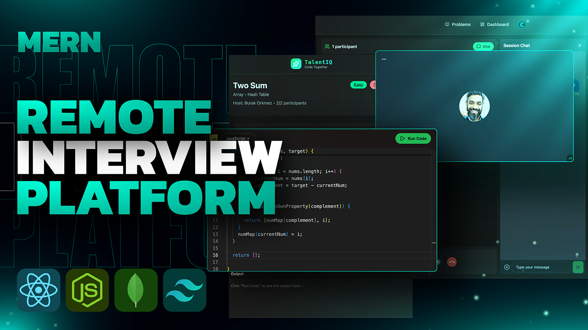

# TALENT-IQ 🧠



A modern, real-time interview collaboration platform built with React and Node.js.
Practice coding problems, run code instantly, and conduct live interview sessions with video + chat in one place.

## 📋 Table of Contents

- [Features](#-features)
- [Tech Stack](#-tech-stack)
- [Project Structure](#-project-structure)
- [Prerequisites](#-prerequisites)
- [Installation and Setup](#-installation-and-setup)
- [Environment Variables](#-environment-variables)
- [Running the Application](#-running-the-application)
- [Project Architecture](#-project-architecture)
- [API Endpoints](#-api-endpoints)
- [Usage Guide](#-usage-guide)
- [Development Notes](#-development-notes)
- [Contributing](#-contributing)
- [Troubleshooting](#-troubleshooting)

## ✨ Features

- 🔐 Authentication with Clerk
- 📹 Real-time video sessions powered by Stream Video
- 💬 Live in-session chat via Stream Chat
- 👥 Session lifecycle: create, join, track, and end interview rooms
- 💻 Multi-language code execution through JDoodle (JavaScript, Python, Java, C++)
- 🧩 Problem practice pages with starter code and output validation
- 📊 Dashboard with active sessions and recent completed sessions
- ⚡ Fast and responsive UI built with React, TailwindCSS, and DaisyUI

## 🛠 Tech Stack

### Frontend

- ⚛️ Framework: React 19 + Vite
- 🎨 Styling: TailwindCSS + DaisyUI
- 🧭 Routing: React Router
- 🔄 Data Fetching: TanStack React Query
- 📝 Code Editor: Monaco Editor
- 📡 API Client: Axios
- 🎥 Video SDK: Stream Video React SDK
- 💬 Chat SDK: Stream Chat React
- 🔔 Notifications: React Hot Toast

### Backend

- 🖥 Runtime: Node.js
- 🚀 Framework: Express 5
- 🗄 Database: MongoDB + Mongoose
- 🔐 Auth Integration: Clerk Express middleware
- 🎥 Chat/Video Infra: Stream Chat + Stream Node SDK
- ⚙️ Event Processing: Inngest
- 🌐 CORS + JSON APIs: Express middlewares
- 🔧 Dev Tooling: Nodemon + dotenv

## 📁 Project Structure

```text
REMOTE INTERVIEW PLATFORM/
├── backend/
│   ├── src/
│   │   ├── server.js
│   │   ├── controllers/
│   │   │   ├── chatController.js
│   │   │   └── sessionController.js
│   │   ├── routes/
│   │   │   ├── chatRoutes.js
│   │   │   ├── executeRoutes.js
│   │   │   └── sessionRoutes.js
│   │   ├── middleware/
│   │   │   └── protectRoute.js
│   │   ├── lib/
│   │   │   ├── db.js
│   │   │   ├── env.js
│   │   │   ├── inngest.js
│   │   │   └── stream.js
│   │   └── models/
│   │       ├── Session.js
│   │       └── User.js
│   └── package.json
│
├── frontend/
│   ├── src/
│   │   ├── App.jsx
│   │   ├── main.jsx
│   │   ├── api/
│   │   │   └── sessions.js
│   │   ├── components/
│   │   ├── hooks/
│   │   │   ├── useSessions.js
│   │   │   └── useStreamClient.js
│   │   ├── pages/
│   │   │   ├── HomePage.jsx
│   │   │   ├── DashboardPage.jsx
│   │   │   ├── ProblemsPage.jsx
│   │   │   ├── ProblemPage.jsx
│   │   │   └── SessionPage.jsx
│   │   └── lib/
│   │       ├── axios.js
│   │       ├── stream.js
│   │       └── piston.js
│   └── package.json
│
└── package.json
```

## 📦 Prerequisites

- Node.js 18+
- npm 9+
- MongoDB Atlas (or local MongoDB)
- Clerk project (publishable + secret keys)
- Stream project (API key + secret)
- JDoodle API credentials
- Inngest keys

## 🚀 Installation and Setup

### 1) Install Dependencies

From project root:

```bash
npm run build
```

This command:
- Installs backend dependencies
- Installs frontend dependencies
- Builds frontend for production

### 2) Optional Manual Install

```bash
npm install --prefix backend
npm install --prefix frontend
```

## 🔑 Environment Variables

### Backend (`backend/.env`)

```env
PORT=5001
NODE_ENV=development
DB_URI=mongodb+srv://<username>:<password>@<cluster>/<dbName>

INNGEST_EVENT_KEY=<inngest_event_key>
INNGEST_SIGNING_KEY=<inngest_signing_key>

STREAM_API_KEY=<stream_api_key>
STREAM_API_SECRET=<stream_api_secret>

CLERK_PUBLISHABLE_KEY=<clerk_publishable_key>
CLERK_SECRET_KEY=<clerk_secret_key>

CLIENT_URL=http://localhost:5173

JOODLE_CLIENT_ID=<jdoodle_client_id>
JOODLE_CLIENT_SECRET=<jdoodle_client_secret>
```

### Frontend (`frontend/.env`)

```env
VITE_CLERK_PUBLISHABLE_KEY=<clerk_publishable_key>
VITE_STREAM_API_KEY=<stream_api_key>
VITE_API_UPL=http://localhost:5001/api
```

Important: The frontend uses `VITE_API_UPL` in code. Keep this exact name unless you also refactor the source.

## ▶️ Running the Application

### Option 1: Development Mode (recommended)

Terminal 1 (backend):

```bash
npm run dev --prefix backend
```

Terminal 2 (frontend):

```bash
npm run dev --prefix frontend
```

URLs:
- Frontend: http://localhost:5173
- Backend health: http://localhost:5001/health

### Option 2: Production Mode

```bash
npm run build
npm start
```

The backend serves static frontend assets when `NODE_ENV=production`.

## 🏗 Project Architecture

### Frontend Flow

1. 🔐 Authentication
- Clerk provider wraps the app and protects private routes.
- Unauthenticated users stay on home/sign-in flow.

2. 📊 Dashboard and Sessions
- Users create interview sessions with problem + difficulty.
- Active and recent sessions are fetched with React Query.

3. 🎥 Live Session Experience
- Session page initializes Stream Video call + chat channel.
- Host and participant collaborate in real time.

4. 💻 Code Execution
- Code editor sends language + script to backend execution API.
- Output panel displays run results and errors.

### Backend Flow

1. 🔐 Request Protection
- Protected routes use Clerk auth via middleware.
- Middleware resolves Clerk user to MongoDB user document.

2. 👥 Session Lifecycle
- Create session: persists to MongoDB + creates Stream call/channel.
- Join session: validates capacity and adds participant + channel member.
- End session: host-only action, tears down Stream resources and closes session.

3. ⚙️ User Sync
- Inngest handles Clerk user create/delete events.
- Stream user records are upserted/deleted accordingly.

## 📡 API Endpoints

### Health

| Method | Endpoint | Description |
|--------|----------|-------------|
| GET | `/health` | Service health check |

### Sessions (`/api/sessions`)

| Method | Endpoint | Description |
|--------|----------|-------------|
| POST | `/` | Create a new interview session |
| GET | `/active` | Get active sessions |
| GET | `/my-recent` | Get current user's recent completed sessions |
| GET | `/:id` | Get session by ID |
| POST | `/:id/join` | Join an active session |
| POST | `/:id/end` | End a session (host only) |

### Chat (`/api/chat`)

| Method | Endpoint | Description |
|--------|----------|-------------|
| GET | `/token` | Generate Stream token for authenticated user |

### Code Execution (`/api/code`)

| Method | Endpoint | Description |
|--------|----------|-------------|
| POST | `/execute` | Execute submitted code via JDoodle |

### Inngest

| Method | Endpoint | Description |
|--------|----------|-------------|
| POST | `/api/inngest` | Inngest event handler endpoint |

## 💬 Usage Guide

### 1) Sign In

- Open the app and authenticate through Clerk.

### 2) Create a Session

- Navigate to Dashboard.
- Choose a problem and difficulty.
- Create room and enter session.

### 3) Join an Existing Session

- Open a session link (`/session/:id`) from host.
- If seat is available, you join as participant.

### 4) Collaborate Live

- Discuss on video call.
- Exchange messages in chat.
- Solve in the code editor and run code instantly.

### 5) End Session

- Host can end the interview room.
- Session is marked completed and shown in recent history.

## 📝 Development Notes

### Root Scripts

- `npm run build` -> install both apps + build frontend
- `npm start` -> start backend app

### Backend Scripts

- `npm run dev` -> start backend with nodemon
- `npm start` -> start backend with node

### Frontend Scripts

- `npm run dev` -> Vite dev server
- `npm run build` -> production build
- `npm run preview` -> preview built app
- `npm run lint` -> run ESLint

## 🤝 Contributing

1. Fork the repository
2. Create a feature branch (`git checkout -b feature/amazing-feature`)
3. Commit changes (`git commit -m "Add amazing feature"`)
4. Push branch (`git push origin feature/amazing-feature`)
5. Open a pull request

## 🆘 Troubleshooting

### Backend does not start

- Confirm `backend/.env` exists and required keys are present.
- Verify MongoDB URI and credentials.
- Check if port is already in use.

### Frontend cannot reach backend

- Confirm backend is running on configured port.
- Verify `VITE_API_UPL` in `frontend/.env`.
- Ensure `CLIENT_URL` in backend matches frontend origin.

### Video/chat connection fails

- Validate Stream API key/secret in backend.
- Validate frontend `VITE_STREAM_API_KEY`.
- Ensure users are authenticated before entering session.

### Code execution errors

- Verify JDoodle client ID/secret values.
- Check submitted language is supported.

## 📄 License

ISC

---

Built with focus for technical interview collaboration. Happy coding! 🚀
